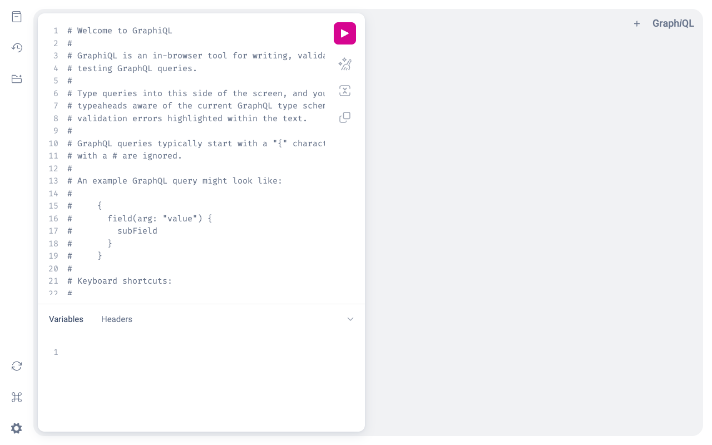
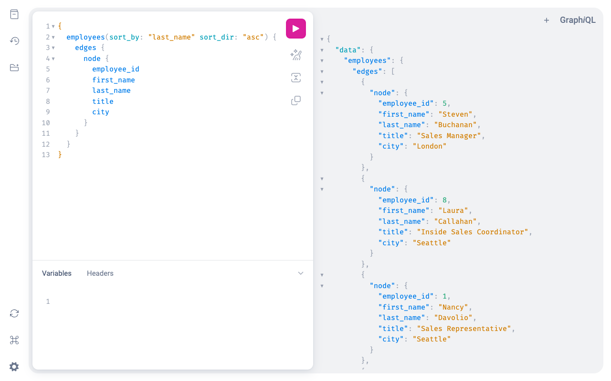
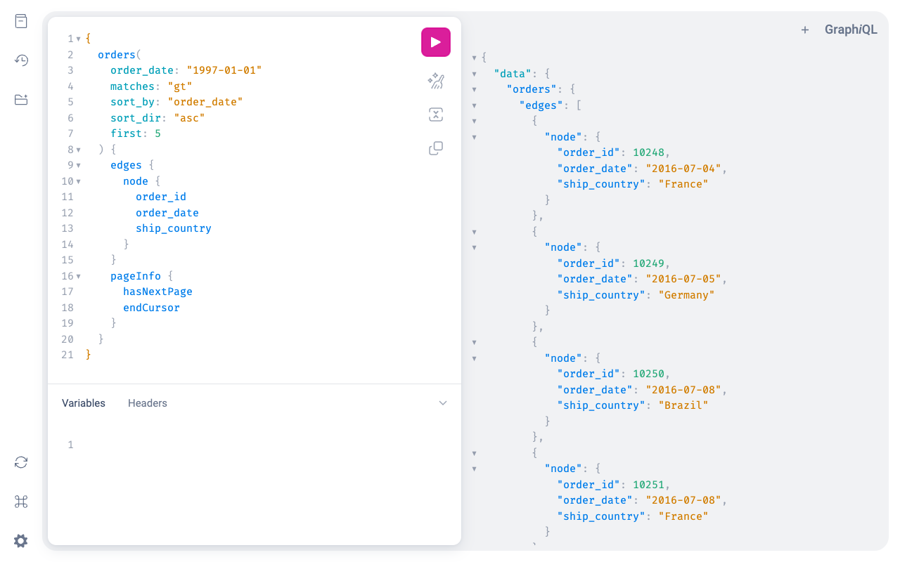
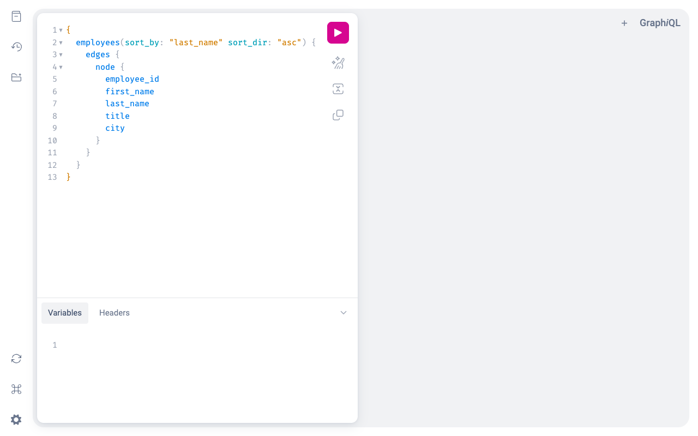
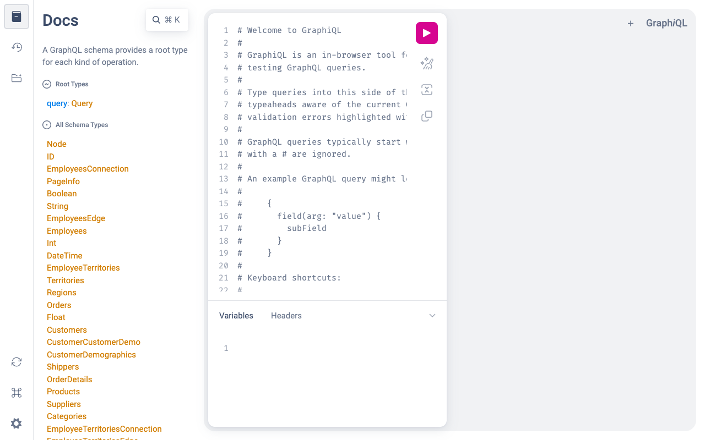
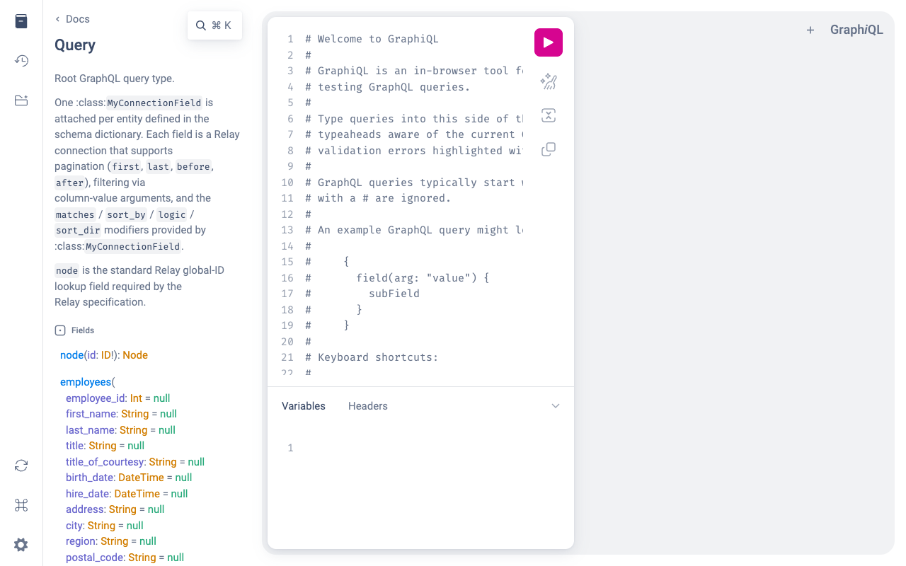

# Grapinator GraphiQL User Guide

## Overview

GraphiQL is an interactive, browser-based IDE for exploring and querying the Grapinator GraphQL API. It provides auto-complete, inline documentation, query history, and a schema explorer — no additional tools or authentication required.

---

## Accessing GraphiQL

Open your browser and navigate to the API endpoint:

```
http://localhost:8443/northwind/gql
```

> **Note:** The host, port, and path may differ in your deployment. Check with your administrator if the default URL does not respond.

### Using GraphiQL with RBAC

For local RBAC work, use `grapinator/resources/grapinator_rbac.ini` with
`AUTH_MODE = mixed` and `GRAPHIQL_ACCESS = open`. This lets the browser load the
IDE HTML without a token; it does **not** make GraphQL queries public. Every
query, including schema introspection, still needs a valid Bearer token.

Start the helper from the repository root after exporting `GQLAPI_CRYPT_KEY`:

```bash
export GQLAPI_CRYPT_KEY=your-local-crypt-config-key
./tools/run_rbac_graphiql.sh
```

The script starts Gunicorn and prints a short-lived HR token as a JSON header.
In GraphiQL, open the **HTTP Headers** panel and paste that JSON, for example:

```json
{"Authorization": "Bearer eyJ..."}
```

Then use the toolbar's schema re-fetch action. The protected fields will appear
in the Docs explorer for roles included in the token. Do not use the bundled
development secret or this helper in a shared or production environment.

---

## Interface Layout

When you first open GraphiQL you will see the default landing page with the query editor on the left and a blank results panel on the right.



The interface is divided into four areas:

| Area | Location | Purpose |
|---|---|---|
| **Toolbar** | Left edge (icons) | Navigation: History, Explorer, Schema re-fetch, Shortcuts, Settings |
| **Query Editor** | Centre-left (large panel) | Write your GraphQL queries here |
| **Results Panel** | Centre-right (large panel) | JSON response appears here after running a query |
| **Variables / Headers** | Bottom of the editor panel | Supply variable values or custom HTTP headers |
| **Docs Explorer** | Slides out from the left | Browse all available types, fields, and arguments |

---

## Running Your First Query

1. Click in the **Query Editor** (left panel) and clear any existing content.
2. Type or paste a query, for example:

```graphql
{
  employees(sort_by: "last_name" sort_dir: "asc") {
    edges {
      node {
        employee_id
        first_name
        last_name
        title
      }
    }
  }
}
```

3. Press the **▶ Run** button (or `Ctrl+Enter` / `Cmd+Enter`) to execute.
4. Results appear as JSON in the right panel.



---

## Query Structure

All Grapinator queries follow the same Relay connection pattern:

```graphql
{
  <entity_name>(<filter_args>) {
    edges {
      node {
        <field1>
        <field2>
        ...
      }
    }
  }
}
```

- **`<entity_name>`** — the data set to query (e.g. `employees`, `orders`, `products`)
- **`edges { node { ... } }`** — Relay wrapper required to access individual records
- **`<field1>, <field2>`** — the columns you want returned

---

## Filtering with `where`

Every entity connection accepts a typed `where` argument (since v2.2.0). Each
key in `where` is a filterable column, and each column takes an object of
operators. Its type is `<Entity>Filter` (for example `EmployeesFilter`), and
each column uses the filter type for its scalar (`StringFilter`, `IntFilter`,
`FloatFilter`, `DateTimeFilter`, and so on). Use auto-complete or the Docs
panel to see the columns and operators available to you.

```graphql
{
  employees(where: {
    region:    { isNull: false }
    hire_date: { gte: "2013-01-01T00:00:00" }
    or: [
      { city: { in: ["Seattle", "Redmond"] } }
      { last_name: { startsWith: "Da" } }
    ]
  }, sort_by: "last_name") {
    edges { node { employee_id last_name city hire_date } }
  }
}
```

### Operators

| Operator | Applies to | SQL |
|---|---|---|
| `eq` / `ne` | all scalars | `=` / `!=` (exact, case-sensitive for strings) |
| `in` / `notIn` | all scalars except Boolean | `IN (...)` / `NOT IN (...)` |
| `gt` / `gte` / `lt` / `lte` | Int, BigInt, Float, Decimal, Date, DateTime, Time | `>` / `>=` / `<` / `<=` |
| `contains` / `startsWith` / `endsWith` | String | case-insensitive `ILIKE`; `%` and `_` in the value are matched literally |
| `isNull` | all scalars | `true` → `IS NULL`; `false` → `IS NOT NULL` |

There is no regular-expression operator in `where`. `matches: "regex"` is
still available through the deprecated arguments described below.

### Combining conditions

- Keys in one filter object, and operators in one column object, are combined with AND.
- `and: [...]` requires every filter in the list to match; `or: [...]` requires at least one.
- `not: {...}` negates a filter.
- These can be nested up to 8 levels deep, with at most 100 operator conditions in total.

```graphql
# Two employee ids: in, or the equivalent or form
{ employees(where: { employee_id: { in: [1, 5] } }) { edges { node { employee_id } } } }
{ employees(where: { or: [{ employee_id: { eq: 1 } }, { employee_id: { eq: 5 } }] }) { edges { node { employee_id } } } }

# Everyone outside London
{ employees(where: { not: { city: { eq: "London" } } }) { edges { node { employee_id city } } } }
```

`where` also works with variables:

```graphql
query Employees($filter: EmployeesFilter) {
  employees(where: $filter) { edges { node { employee_id last_name } } }
}
```

```json
{ "filter": { "city": { "eq": "London" }, "employee_id": { "gt": 5 } } }
```

### Worked filter examples

Each example below uses the bundled Northwind schema. Filters restrict rows,
not the fields returned: a column can be filtered without selecting it.
If a server page limit is configured, these examples may return only the first
page; use the [pagination workflow](#pagination) to retrieve the rest.

**Exact matches and exclusions.** Find employees outside London whose IDs are
not in an exclusion list. Both column conditions must match. `eq` and `ne`
are exact comparisons; `notIn` excludes each listed value.

```graphql
query EmployeesOutsideLondon {
  employees(
    where: { city: { ne: "London" }, employee_id: { notIn: [2, 4] } }
    sort_by: "employee_id"
  ) {
    edges { node { employee_id last_name city } }
  }
}
```

**Case-insensitive string searches.** These independent selections demonstrate
substring, prefix, and suffix matching. `%` and `_` in the search value are
literal characters, not SQL wildcards; `contains: "%"` finds an actual percent
sign, not every string.

```graphql
query EmployeeNameSearches {
  substring: employees(where: { last_name: { contains: "LL" } }) {
    edges { node { employee_id last_name } }
  }
  prefix: employees(where: { last_name: { startsWith: "d" } }) {
    edges { node { employee_id last_name } }
  }
  suffix: employees(where: { last_name: { endsWith: "ING" } }) {
    edges { node { employee_id last_name } }
  }
}
```

**Numeric ranges.** Multiple operators on one column are ANDed: include prices
from 10 through 30, but only when stock is greater than zero and at most 50.

```graphql
query ProductsInPriceAndStockRange {
  products(
    where: {
      unit_price: { gte: 10, lte: 30 }
      units_in_stock: { gt: 0, lt: 51 }
    }
    sort_by: "product_id"
  ) {
    edges { node { product_id product_name unit_price units_in_stock } }
  }
}
```

**Date/time ranges.** Use an inclusive lower bound and exclusive upper bound
to include every time on the final day, without guessing its last timestamp.
This example includes hires during 2014, excluding January 1, 2015.

```graphql
query EmployeesHiredIn2014 {
  employees(
    where: { hire_date: { gte: "2014-01-01T00:00:00", lt: "2015-01-01T00:00:00" } }
    sort_by: "employee_id"
  ) {
    edges { node { employee_id last_name hire_date } }
  }
}
```

Supply scalar values in their declared format: integers and floats as JSON
numbers, Boolean values as `true` / `false`, Date as `"2014-01-01"`, DateTime as
`"2014-01-01T00:00:00"`, and Time as `"09:30:00"`. Use only types exposed by
your schema; Northwind has no Boolean column. A Boolean column's filter accepts
`eq`, `ne`, and `isNull`, but not ranges or membership lists. An ID column uses
`eq`, `ne`, `in`, `notIn`, and `isNull`.

**NULL values and inequality.** Retrieve employees who do not report to employee
2, including employees with no manager. A standalone `ne: 2` would exclude NULL.

```graphql
query EmployeesWithOtherOrNoManager {
  employees(
    where: { or: [{ reports_to: { ne: 2 } }, { reports_to: { isNull: true } }] }
    sort_by: "employee_id"
  ) {
    edges { node { employee_id last_name reports_to } }
  }
}
```

Use `reports_to: { isNull: false }` instead to require a manager. NULL is not an
empty string: `city: { eq: "" }` tests an empty string, not a missing value.

**Explicit AND with nested OR and NOT.** Require London or Seattle, exclude
employees 1 and 5, and keep IDs above 3. The outer AND applies to every branch.

```graphql
query NestedEmployeeFilter {
  employees(
    where: {
      and: [
        { or: [{ city: { eq: "London" } }, { city: { eq: "Seattle" } }] }
        { not: { employee_id: { in: [1, 5] } } }
        { employee_id: { gt: 3 } }
      ]
    }
    sort_by: "employee_id"
  ) {
    edges { node { employee_id last_name city } }
  }
}
```

### Null and list semantics

- Omitting `where`, passing `where: null`, or passing `where: {}` applies no filter.
- `and: []` matches every row; `or: []` matches no rows.
- `in: []` matches no rows; `notIn: []` matches every row.
- Use `isNull: true` / `isNull: false` to match NULL / non-NULL values.
  An explicit `null` for any operator (including `isNull`)
  (for example `eq: null`) is rejected with an error that points to `isNull`,
  and `null` is not allowed inside `in` / `notIn` lists.
- SQL comparisons never match NULL: `ne: 5` does not return rows where the
  column is NULL. To include them, put complete column filters inside `or`,
  for example `or: [{ reports_to: { ne: 2 } }, { reports_to: { isNull: true } }]`.
- `in` / `notIn` lists are limited to `MAX_IN_LIST_SIZE` values (default 500);
  longer lists return `List exceeds the maximum of N values.`
- Each operator takes the column's own type, so `employee_id: { in: ["1"] }`
  is a validation error.

### What `where` cannot express

- Filters on related entities (for example employees whose territory is in a given region).
- Comparisons between two columns.
- Aggregates such as counts or `GROUP BY`.
- Resolver, hidden, and non-queryable fields; these cannot be filtered.

### Access control

`where` follows the same rules as the other filters. Columns restricted with
`gql_auth_roles` appear in `<Entity>Filter` only for callers with a matching
role. For other callers, a restricted column produces the same error as a
column that does not exist, and entity- and row-level access rules still limit
the results whatever `or` / `not` conditions are used.

### Migrating from the deprecated arguments

| Deprecated | `where` equivalent |
|---|---|
| `employees(city: "Sea")` (default `contains`) | `employees(where: {city: {contains: "Sea"}})` |
| `employees(city: "Seattle", matches: "exact")` | `employees(where: {city: {eq: "Seattle"}})` |
| `matches: "startswith"` / `"endswith"` | `startsWith` / `endsWith` |
| `matches: "gt"` / `"gte"` / `"lt"` / `"lte"` / `"ne"` | `gt` / `gte` / `lt` / `lte` / `ne` |
| `orders(order_date: "1997-01-01")` (dates default to `>=`) | `orders(where: {order_date: {gte: "1997-01-01T00:00:00"}})` |
| `employees(city: "Seattle", country: "UK", logic: "or")` | `employees(where: {or: [{city: {contains: "Seattle"}}, {country: {contains: "UK"}}]})` |
| `matches: "regex"` | no equivalent; keep using the deprecated arguments |

Note that the deprecated per-column arguments apply a single `matches` mode to
every column, while `where` lets each column use its own operator.

---

## Filtering Results (deprecated arguments)

> **Deprecated:** the per-column arguments, `matches`, and `logic` still work
> exactly as before, but are marked deprecated in the schema and will be
> removed in a future major release. Use [`where`](#filtering-with-where)
> instead. `sort_by`, `sort_dir`, and pagination arguments are not deprecated.
>
> If you pass both, the result is `(deprecated conditions joined by logic) AND
> (where conditions)`. `logic` applies only to the deprecated arguments.

Pass field values as arguments to filter results. Multiple fields are combined with AND logic by default.

### Basic filter — match by field value

```graphql
{
  employees(city: "Seattle") {
    edges {
      node {
        first_name
        last_name
        city
      }
    }
  }
}
```

### Filter mode — `matches` argument

The `matches` argument controls how the filter value is compared. Default is `contains`.

| `matches` value | Behaviour | Example |
|---|---|---|
| `contains` *(default)* | Case-insensitive substring match | `"Smith"` matches `"Blacksmith"` |
| `exact` or `eq` | Exact equality | `"Smith"` matches only `"Smith"` |
| `startswith` or `sw` | Value starts with string | `"Sm"` matches `"Smith"` |
| `endswith` or `ew` | Value ends with string | `"th"` matches `"Smith"` |
| `regex` or `re` | Regular expression match | `"^S.*h$"` matches `"Smith"` |
| `lt` | Less than | numeric or date comparison |
| `lte` | Less than or equal | numeric or date comparison |
| `gt` | Greater than | numeric or date comparison |
| `gte` | Greater than or equal | numeric or date comparison |
| `ne` | Not equal | excludes matching records |

**Example — exact match:**

```graphql
{
  employees(city: "Seattle" matches: "exact") {
    edges {
      node {
        first_name
        last_name
        city
      }
    }
  }
}
```

**Example — date range (orders after 1997-01-01):**

```graphql
{
  orders(order_date: "1997-01-01" matches: "gt" sort_by: "order_date" sort_dir: "asc") {
    edges {
      node {
        order_id
        order_date
        ship_country
      }
    }
  }
}
```



---

## Sorting Results

Use `sort_by` and `sort_dir` to control result order.

| Argument | Values | Default |
|---|---|---|
| `sort_by` | Any field name (string) | Entity's default sort column |
| `sort_dir` | `asc`, `desc` | `asc` |

```graphql
{
  products(sort_by: "unit_price" sort_dir: "desc") {
    edges {
      node {
        product_name
        unit_price
      }
    }
  }
}
```

---

## Combining Filters with OR Logic (deprecated)

By default multiple filters are combined with AND. Use `logic: "or"` to switch to OR.
New queries should use `where` with `or: [...]` instead.

```graphql
{
  employees(city: "Seattle" logic: "or" country: "UK") {
    edges {
      node {
        first_name
        last_name
        city
        country
      }
    }
  }
}
```

---

## Pagination

Grapinator uses Relay cursors, not page numbers. `first` / `after` move forward;
`last` / `before` move backward. Cursors are opaque: copy them from `pageInfo`
instead of constructing them. Prefer one direction per request.

### When MAX_PAGE_SIZE is unset

Omit or comment out the setting in the active INI file, then restart the service:

```ini
[GRAPHENE]
GQL_SCHEMA = schema.dct
# MAX_PAGE_SIZE is omitted: no server-imposed page-size cap.
```

An unpaged query returns all matching, authorized rows. An explicit `first: 50`
or `last: 50` can return up to 50 rows; there is no implicit page size. For the
unmodified Northwind sample, both selections below return all nine employees:

```graphql
query EmployeesWithoutServerCap {
  unpaged: employees(sort_by: "employee_id") {
    edges { node { employee_id } }
    pageInfo { hasNextPage endCursor }
  }
  requested: employees(first: 50, sort_by: "employee_id") {
    edges { node { employee_id } }
    pageInfo { hasNextPage endCursor }
  }
}
```

Both have `hasNextPage: false` for those nine rows. Clients can still paginate
voluntarily using the forward and backward queries below. Leaving the cap unset
does not disable pagination; it only removes the server's upper bound.

### When MAX_PAGE_SIZE is set

For a small, visible demonstration, configure a cap of three and restart:

```ini
[GRAPHENE]
GQL_SCHEMA = schema.dct
MAX_PAGE_SIZE = 3
```

Run `EmployeesWithoutServerCap` again. Both selections now return employee IDs
`[1, 2, 3]` with `hasNextPage: true`: the omitted size defaults to `first: 3`,
and `first: 50` is clamped to three. A smaller request such as `first: 2` is
unchanged. Larger `last` requests are clamped in the same way.

> No truncation error is returned. Always inspect `hasNextPage` for forward
> paging or `hasPreviousPage` for backward paging. A page shorter than the
> requested size does not prove you have reached the end when a cap is set.

### Forward paging with a filter

This query works whether the cap is set or unset. Use the **Variables** panel
to supply the JSON shown below. The London filter matches IDs `[5, 6, 7, 9]`
in the unmodified sample.

```graphql
query EmployeePages($filter: EmployeesFilter, $size: Int = 50, $after: String) {
  employees(
    where: $filter
    first: $size
    after: $after
    sort_by: "employee_id"
    sort_dir: "asc"
  ) {
    edges { node { employee_id first_name last_name city } }
    pageInfo { hasNextPage endCursor }
  }
}
```

First request:

```json
{ "filter": { "city": { "eq": "London" } }, "size": 50, "after": null }
```

With `MAX_PAGE_SIZE = 3`, the first page is `[5, 6, 7]` with `hasNextPage: true`.
Copy its `endCursor` into the next request's `after` variable, leaving the filter,
size, and sorting unchanged:

```json
{ "filter": { "city": { "eq": "London" } }, "size": 50, "after": "<endCursor from the first response>" }
```

Replace the placeholder with the returned cursor. The second page is `[9]` with
`hasNextPage: false`, so stop. When the cap is unset, the first request returns
`[5, 6, 7, 9]` and `hasNextPage: false`. To request two rows at a time with either
configuration, set `size` to `2`; continue replacing `after` until
`hasNextPage` is false. An empty filtered result has no edges, a null cursor,
and `hasNextPage: false`.



### Backward paging

Use `last` and `before` with `startCursor`, not `endCursor`:

```graphql
query PreviousEmployees($before: String) {
  employees(last: 50, before: $before, sort_by: "employee_id", sort_dir: "asc") {
    edges { node { employee_id last_name } }
    pageInfo { hasPreviousPage startCursor }
  }
}
```

Start with `{ "before": null }`. With `MAX_PAGE_SIZE = 3`, the page contains
`[7, 8, 9]`. While `hasPreviousPage` is true, send the returned `startCursor`
as `before`: the next pages are `[4, 5, 6]`, then `[1, 2, 3]`, whose
`hasPreviousPage` is false. With no cap, `last: 50` returns all nine employees
in one page with `hasPreviousPage: false`. Rows within each page retain the
requested ascending order; backward paging does not reverse that order.

### Paging rules and edge cases

- Keep the same `where`, `sort_by`, `sort_dir`, and authorization context for
  every page. Prefer a unique sort field such as `employee_id` or `order_id`.
- These cursors are not a database snapshot. Concurrent inserts, deletes, or
  sort-field changes can cause missing or repeated records across requests.
- If both sizes are omitted or null, a configured cap supplies `first`.
  `first: 0` or `last: 0` explicitly requests zero rows; it does not select
  the default size. Zero is not a valid INI value for `MAX_PAGE_SIZE`.
- To restore uncapped behavior, remove or comment out `MAX_PAGE_SIZE` and
  restart. Do not set it to `0`, a blank value, or the string `None`.
- Limits apply separately to each entity connection, not to the total number
  of rows across aliases or related fields in a response. Row/entity access
  policies still apply before the returned page is assembled.

See the [configuration reference](grapinator_ini.md#graphene) for deployment
settings and the [demo queries](demo_queries.md#pagination-with-and-without-a-server-cap)
for a compact set/unset comparison.

---

## Traversing Relationships

Fields referencing related tables can be nested directly in your query. No separate joins are required.

```graphql
{
  orders(customer_id: "ALFKI") {
    edges {
      node {
        order_id
        order_date

        employee {
          first_name
          last_name
        }

        customer {
          company_name
          phone
        }
      }
    }
  }
}
```

Relationships can be nested multiple levels deep:

```graphql
{
  order_details(order_id: 10248) {
    edges {
      node {
        quantity
        unit_price

        product {
          product_name

          category {
            category_name
          }

          supplier {
            company_name
            country
          }
        }
      }
    }
  }
}
```

---

## Using the Schema Explorer (Docs)

Click the **Docs** button in the top-right corner to open the schema explorer. This panel lets you browse every available entity, field, and argument without writing a query.



**To explore an entity:**
1. Click **Query** at the root level.
2. Click any entity name (e.g. `employees`) to see its available filter arguments.
3. Click on a type name to drill into its fields.



**Deprecated fields** are hidden by default. Toggle **"Show Deprecated Fields"** inside the explorer to reveal them — deprecated fields display a strikethrough name and the deprecation reason explaining what to use instead.

---

## Keyboard Shortcuts

| Shortcut | Action |
|---|---|
| `Ctrl+Enter` / `Cmd+Enter` | Run query |
| `Ctrl+Space` | Trigger auto-complete |
| `Shift+Ctrl+P` / `Shift+Cmd+P` | Prettify / format query |

---

## Auto-complete

Press `Ctrl+Space` (or `Cmd+Space`) at any point in the query editor to see available options for the current cursor position — entity names, field names, argument names, and valid enum values are all suggested automatically.

---

## Common Errors

| Error | Likely cause |
|---|---|
| `Cannot query field "X" on type "Y"` | Field name is wrong or does not exist — check spelling in the Docs panel |
| `Unknown argument "X"` | Argument name is wrong — use auto-complete to see valid arguments |
| `Expected type String, found Int` | Value type mismatch — wrap string values in double quotes |
| `Field "X" is not defined by type "EmployeesFilter"` | Column name in `where` is wrong, not filterable, or not available to your role |
| `Null is not allowed for 'eq'; use isNull to match null values.` | Use `{ isNull: true }` instead of `{ eq: null }` |
| `List exceeds the maximum of N values.` | Split the `in` / `notIn` list across several queries |
| `Filter nesting exceeds the maximum depth of 8.` / `Filter exceeds the maximum of 100 conditions.` | Simplify the `where` tree, for example by using `in` instead of many `or` branches |
| Empty `edges` array | Query ran successfully but no rows matched the filter |
| Network error / cannot connect | Server is not running or the URL is incorrect |

---

## Further Reading

- [demo_queries.md](demo_queries.md) — ready-to-run example queries for every entity
- [schema_docs.md](schema_docs.md) — full schema reference including field descriptions and relationship definitions
